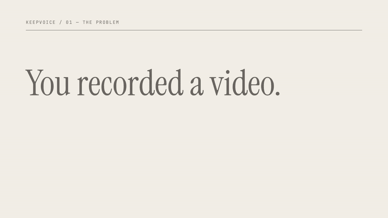
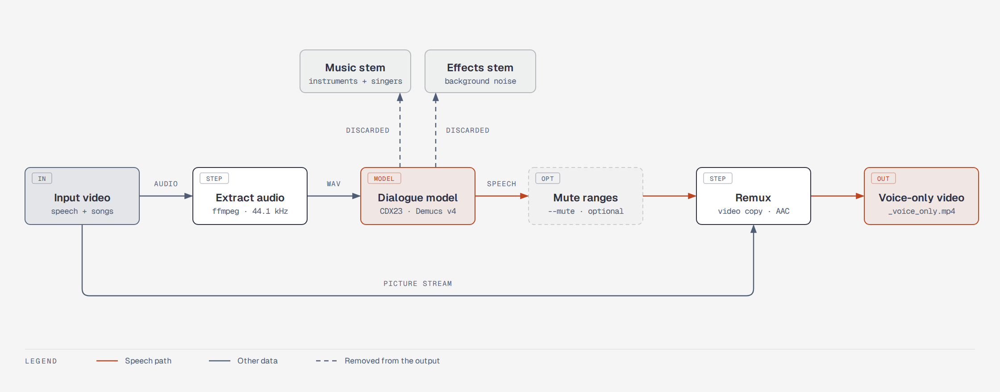
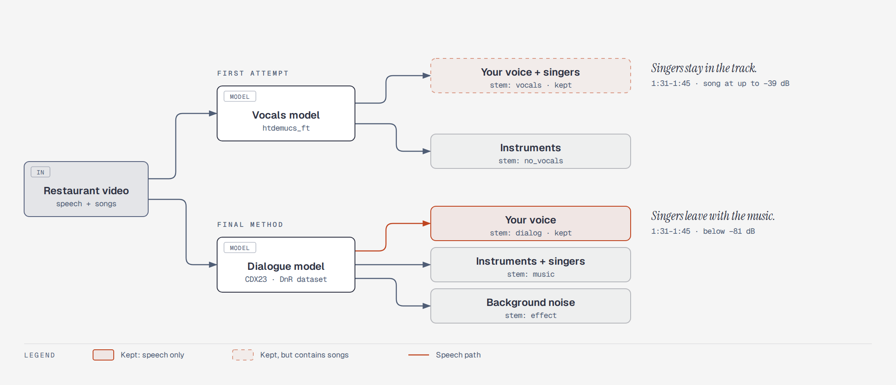

# keepvoice

Remove music from a video and keep the speech. It also removes songs that have singing, which a normal vocal remover cannot do.

Use it when a video has copyrighted music in the background (a restaurant, a shop, a car radio) and you want to publish the video with only your voice, or with music that you have a licence for.

[](docs/demo/keepvoice-demo.mp4)

The preview has no sound. [Open the demo video with narration](docs/demo/keepvoice-demo.mp4) (38 seconds).

## Install

You need Python 3.10 or later, [ffmpeg](https://ffmpeg.org/download.html) and approximately 2 GB of disk space for PyTorch.

```bash
uv tool install git+https://github.com/yablokolabs/keepvoice
```

or

```bash
pip install git+https://github.com/yablokolabs/keepvoice
```

The first run downloads the model checkpoints (160 MB) to `~/.cache/keepvoice`.

## Use

```bash
keepvoice video.mp4
```

This writes `video_voice_only.mp4` next to the input. The input file is not changed.

| Option | Function |
|---|---|
| `-o PATH` | Set the output path. |
| `--mute START-END` | Make a time range fully silent. Use it for sections where you do not speak, for example an intro with music: `--mute 0-17 --mute 3:07-3:13.4`. You can give it more than one time. |
| `--fast` | Use 1 model checkpoint instead of 3. Processing is approximately 3 times faster and the separation is less clean. |

Times are seconds (`17`, `193.4`) or clock times (`3:07`, `1:02:03.5`).

## How it works



1. ffmpeg extracts the audio as 44.1 kHz stereo.
2. A dialogue model splits the audio into three stems: speech, music and effects.
3. Only the speech stem is kept. Time ranges given with `--mute` are made silent.
4. ffmpeg joins the speech with the picture. The picture stream is copied, not encoded again, so there is no quality loss.

### Why a vocals model is not sufficient



Most "remove the music" tools use a model that was trained on songs. It splits a song into vocals and instruments, so it keeps all human voice. If the background music has a singer, the singer stays in the result with your voice.

keepvoice uses a model that was trained on film sound, where the task is to separate dialogue from the music score and from sound effects. For that model, a singer is part of the music.

More detail is in [docs/how-it-works.md](docs/how-it-works.md).

## Measured result

Test input: a phone video of 3 minutes 25 seconds, recorded in a restaurant that played songs with singing. The table shows the level of the sound that stays in the output, in sections where nobody speaks.

| Section | Vocals model (htdemucs_ft) | keepvoice |
|---|---|---|
| 1:31 to 1:45, song with singing | up to −39 dB (singing can be heard) | below −81 dB (silence) |
| 1:02 to 1:24, loudest music | below −63 dB | below −82 dB |
| Picture stream | not applicable | identical checksum to the input |

Processing took approximately 20 minutes on 4 CPU cores with no GPU. With a CUDA GPU, PyTorch uses it automatically.

## Limits

- Where you speak at the same time as a song, a faint trace of the song can stay below your voice.
- Background sound (room noise, traffic) is removed together with the music. The pauses between sentences are fully silent.
- The speech level is not changed. Set the level when you add your new music.
- The model works at 44.1 kHz stereo. Surround audio is mixed down to stereo.
- A model can make mistakes. Listen to the full result before you publish it. keepvoice does not guarantee that a platform will not detect the music.
- The checkpoints are PyTorch pickle files from a third-party release. Loading a pickle file can run code, so the files are downloaded only from the URL in `keepvoice/separate.py`.

## Development

```bash
git clone https://github.com/yablokolabs/keepvoice && cd keepvoice
uv venv && uv pip install -e . pytest ruff
.venv/bin/pytest            # fast tests: real ffmpeg, no model
.venv/bin/pytest -m slow    # runs the real model (downloads checkpoints)
.venv/bin/ruff check . && .venv/bin/ruff format --check .
```

The fast tests make a small video with ffmpeg, run the pipeline, and measure the output: the picture checksum, the length and the audio level in each time range.

The diagrams and the demo video have their own instructions in [demo-video/README.md](demo-video/README.md).

## Credits

- Separation model: [MVSEP-CDX23-Cinematic-Sound-Demixing](https://github.com/ZFTurbo/MVSEP-CDX23-Cinematic-Sound-Demixing) by ZFTurbo (MIT). The checkpoints are Demucs v4 models trained on the Divide and Remaster dataset.
- [Demucs](https://github.com/facebookresearch/demucs) by Meta Research (MIT).
- Diagrams: [diagram-design](https://github.com/cathrynlavery/diagram-design) by Cathryn Lavery (MIT).
- Demo video: [videowright](https://github.com/scosman/videowright) by Steve Cosman (MIT). Voice-over generated with [ElevenLabs](https://elevenlabs.io).

## License

[MIT](LICENSE)
